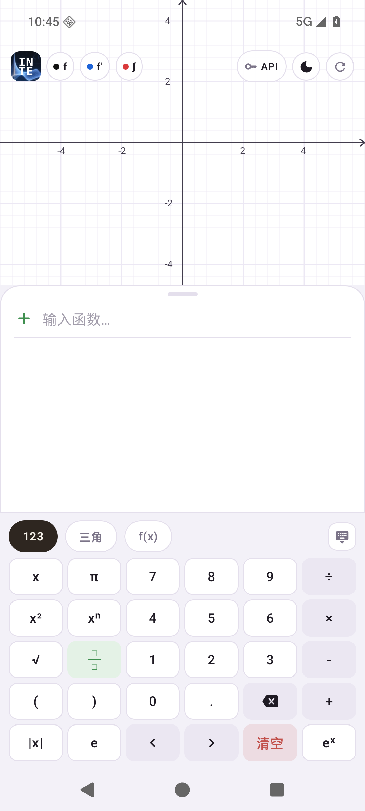
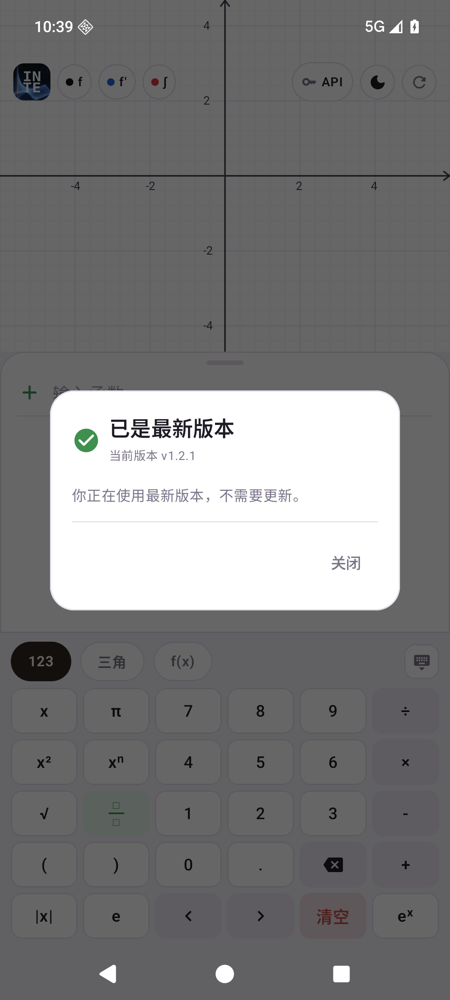
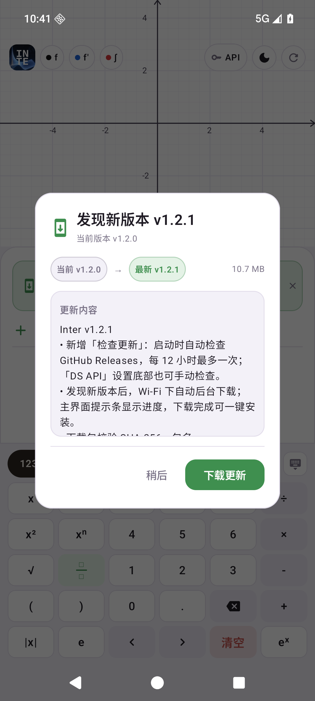

# Inter v1.2.1 — 微积分绘图与 AI 积分学习助手（Android）

**Inter** 是使用 **Kotlin + Jetpack Compose (Material 3)** 构建的 Android 微积分学习应用：实时输入 LaTeX、绘制原函数 / 导数 / 积分三色曲线，并可调用 DeepSeek 输出积分方法讲解。视觉风格沿用 [ssyPromax/ToDoList](https://github.com/ssyPromax/ToDoList) 的极简扁平双主题体系。

## v1.2.1 新增：应用内检查更新 / 自动更新

- 启动时自动检查 GitHub Releases，每 12 小时最多一次。
- 发现新版本后，**Wi-Fi 下自动在后台下载**；移动网络下只提示，点一下再下载。
- 主界面会出现更新提示条：下载进度、下载完成、失败原因都在这里，不打断输入。
- 下载完成后点「安装更新」交给系统安装。Android 出于安全限制，**必须由用户确认一次安装**，普通应用无法真正静默安装。
- 下载包会依次校验 **SHA-256 → 包名 → versionCode → 签名**，任何一项不匹配都拒绝安装。
- 「DS API」设置弹窗底部新增「检查更新」入口和当前版本号。

## 首次从 v1.2.0 升级：必须先卸载一次

v1.2.0 是另一份签名（Gemini 的调试签名）打的包，Android 不允许不同签名的 APK 覆盖安装。
请先卸载旧版，再安装 v1.2.1：

1. 卸载旧版会清除应用内的 **DeepSeek API Key、主题、更新记录**等本地设置，请先记下 Key。
2. 从 [Releases](https://github.com/ssyPromax/Inter/releases) 下载 `Inter-v1.2.1.apk` 安装。
3. 从 v1.2.1 起，后续版本可以在应用内直接更新。

## 截图

| 主界面 | 检查更新 | 更新提示 |
|---|---|---|
|  |  |  |

## 主要功能

- **实时 LaTeX 输入**：离线 KaTeX 渲染分数、根号、幂次。
- **三色微积分图像**：原函数 `f(x)` 黑色、导数 `f'(x)` 蓝色、积分 `∫f(x)dx` 红色，支持拖拽、双指缩放、曲线标注。
- **代数区**：展示化简后的 `f(x)`、`f'(x)`、`∫f(x)dx`。
- **DeepSeek 积分思路**：多行对齐 LaTeX 解法，支持连续追问。
- **深浅双主题**：色值来自 `dswork-suite` 设计令牌，不在 App 内硬编码。

## 更新源

| 顺序 | 地址 | 说明 |
|---|---|---|
| 1 | `https://github.com/ssyPromax/Inter/releases/latest/download/update.json` | 最新 Release 里的元数据，带 `versionCode`、`sha256`、更新说明，不限流 |
| 2 | `https://api.github.com/repos/ssyPromax/Inter/releases/latest` | 第一项不可用时的回退，匿名 API 每小时 60 次 |

更新逻辑在 `app/src/main/java/com/inter/calc/update/`。

## 构建

环境：Android Studio Ladybug+ / JDK 17+（本机用 JDK 21 验证）/ Android SDK 35。

```bash
cd Inter
./gradlew :app:assembleRelease
```

产物：`app/build/outputs/apk/release/app-release.apk`。

签名：仓库不含签名材料。维护者本地需要：

- `keystore/inter-release.jks`
- `keystore.properties`（`storeFile`、`storePassword`、`keyAlias`、`keyPassword`）

两者都已在 `.gitignore` 中。缺少 `keystore.properties` 时 release 会退回 debug 签名，只能用于本地测试。

## 发布新版本

```bash
# 1. 改 app/build.gradle.kts 的 versionCode / versionName
# 2. 打包并复制到 dist/
./gradlew :app:assembleRelease
cp app/build/outputs/apk/release/app-release.apk dist/Inter-v1.2.1.apk

# 3. 先同步代码到 GitHub
python D:/.dswork/App/suite/tools/sync-all.py

# 4. 创建 Release 并上传 APK + update.json
python tools/release.py \
  --version 1.2.1 \
  --version-code 4 \
  --apk dist/Inter-v1.2.1.apk \
  --notes-file RELEASE_NOTES.md
```

`tools/release.py` 会读取 `GITHUB_TOKEN`（或 Windows 用户环境变量），只上传 Release 资产，不打印 token。

## 目录

```
Inter/
  app/src/main/java/com/inter/calc/
    data/       DeepSeek 配置与流式客户端
    math/       表达式解析、求导、积分、数值采样
    update/     检查更新、下载、校验、安装
    ui/         Compose 界面、更新提示条与更新弹窗
    ui/theme/   DsTokens.kt（生成）+ 主题映射
  tools/release.py
  RELEASE_NOTES.md
```

## 设计系统

Inter 已注册进 `dswork-suite`（`suite/design/apps.json` 的 `inter` 条目）。
颜色/圆角/间距/字号只改 `suite/design/tokens.json`，然后运行：

```bash
python D:/.dswork/App/suite/design/gen.py
python D:/.dswork/App/suite/design/gen.py --check
```

`app/src/main/java/com/inter/calc/ui/theme/DsTokens.kt` 是生成文件，不要手改。

---

## 许可证

本项目采用 [GNU General Public License v3.0](LICENSE)（GPL-3.0）。

Copyright (C) 2026 ssyPromax

你可以自由使用、修改和分发本项目的代码；如果你分发修改后的版本，
必须以同样的 GPL-3.0 协议公开源代码。
